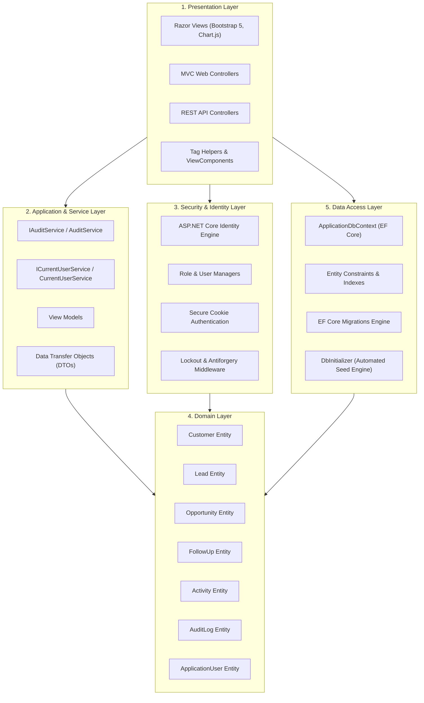

# System Architecture Document

## 1. Executive Summary

AcxiomCRM is an enterprise-grade Customer Relationship Management (CRM) platform engineered with ASP.NET Core 8 MVC, Entity Framework Core 8, ASP.NET Core Identity, and Bootstrap 5. The platform implements a structured multi-tiered architecture that strictly decouples concerns across presentation, business services, data persistence, and security infrastructure.

The system is designed in accordance with Section 17.20 (Project Completion Standard) of the official Software Requirements Specification (SRS), fulfilling not just database CRUD capabilities, but complete CRM business workflows, multi-tiered validation, role-based authorization boundaries, live dashboard telemetry, an immutable audit trail, and RESTful API endpoints.

---

## 2. Layered Architecture Overview

The application adheres to an N-Tier Onion Architecture pattern, ensuring unidirectional dependency flow from outer delivery layers toward the core domain models.

---

## 3. Layer Breakdown and Responsibilities

### 3.1 Presentation Layer
- **MVC Controllers**: Located in [Controllers/](file:///c:/Users/vikra/Axciom-CRM/Controllers). Handle HTTP requests, orchestrate application services, validate ModelState, bind ViewModels, and return Razor Views.
  - [AccountController.cs](file:///c:/Users/vikra/Axciom-CRM/Controllers/AccountController.cs): Authentication, registration, logout, lockout management.
  - [DashboardController.cs](file:///c:/Users/vikra/Axciom-CRM/Controllers/DashboardController.cs): 8 KPI metrics aggregation, 3 Chart.js dataset generation, date filtering.
  - [CustomersController.cs](file:///c:/Users/vikra/Axciom-CRM/Controllers/CustomersController.cs): Customer management, duplication check, Customer 360 view.
  - [LeadsController.cs](file:///c:/Users/vikra/Axciom-CRM/Controllers/LeadsController.cs): Lead lifecycle, status transitions, Lead-to-Customer conversion wizard.
  - [OpportunitiesController.cs](file:///c:/Users/vikra/Axciom-CRM/Controllers/OpportunitiesController.cs): Pipeline stages, probability sync, weighted forecast calculations.
  - [FollowUpsController.cs](file:///c:/Users/vikra/Axciom-CRM/Controllers/FollowUpsController.cs): Follow-up scheduling, overdue detection, reschedule workflow.
  - [ActivitiesController.cs](file:///c:/Users/vikra/Axciom-CRM/Controllers/ActivitiesController.cs): Interaction logging across calls, meetings, emails, tasks.
  - [UsersController.cs](file:///c:/Users/vikra/Axciom-CRM/Controllers/UsersController.cs): Administrator-only role assignments, user status toggles, password resets.
  - [AuditLogsController.cs](file:///c:/Users/vikra/Axciom-CRM/Controllers/AuditLogsController.cs): Read-only system audit trail exploration.
  - [ReportsController.cs](file:///c:/Users/vikra/Axciom-CRM/Controllers/ReportsController.cs): 8 comprehensive business reports with print/export views.
- **REST API Controllers**: Located in [Controllers/Api/](file:///c:/Users/vikra/Axciom-CRM/Controllers/Api). Provide programmatic access using JSON payloads, proper status codes (`200`, `201`, `400`, `401`, `403`, `404`, `409`, `423`), and DTO contracts.
- **Razor Views**: Located in [Views/](file:///c:/Users/vikra/Axciom-CRM/Views). Responsive templates utilizing Bootstrap 5, Chart.js for data visualization, and jQuery Unobtrusive Validation for instant client feedback.

### 3.2 Application and Service Layer
- **Current User Service**: [CurrentUserService.cs](file:///c:/Users/vikra/Axciom-CRM/Services/CurrentUserService.cs) implementing [ICurrentUserService.cs](file:///c:/Users/vikra/Axciom-CRM/Services/ICurrentUserService.cs).
  - Resolves authenticated user identity, primary role (`Admin`, `Manager`, `SalesExecutive`), and user ID.
  - Provides IP address resolution from `HttpContext`.
  - Enforces data isolation by scoping database queries to assigned records when the user is a Sales Executive.
- **Audit Logging Service**: [AuditService.cs](file:///c:/Users/vikra/Axciom-CRM/Services/AuditService.cs) implementing [IAuditService.cs](file:///c:/Users/vikra/Axciom-CRM/Services/IAuditService.cs).
  - Provides asynchronous, append-only logging of user actions, entity mutations (with OldValue and NewValue tracking), authentication events, and administrative overrides.
- **DTOs and ViewModels**:
  - DTOs defined in [CrmDtos.cs](file:///c:/Users/vikra/Axciom-CRM/DTOs/CrmDtos.cs) ensure that internal domain entities and sensitive properties (such as password hashes) are never exposed via the API.
  - ViewModels in [ViewModels/](file:///c:/Users/vikra/Axciom-CRM/ViewModels) encapsulate UI-specific state, validation attributes, and aggregation structures.

### 3.3 Domain Layer
- **Entities**: Located in [Models/](file:///c:/Users/vikra/Axciom-CRM/Models).
  - [Customer.cs](file:///c:/Users/vikra/Axciom-CRM/Models/Customer.cs): Customer profile, unique contact information, account status.
  - [Lead.cs](file:///c:/Users/vikra/Axciom-CRM/Models/Lead.cs): Prospect lifecycle, expected value, conversion relationship links.
  - [Opportunity.cs](file:///c:/Users/vikra/Axciom-CRM/Models/Opportunity.cs): Deal amounts, sales stages, win probability, weighted revenue calculation.
  - [FollowUp.cs](file:///c:/Users/vikra/Axciom-CRM/Models/FollowUp.cs): Action items linked polymorphically to Customers or Leads, execution status.
  - [Activity.cs](file:///c:/Users/vikra/Axciom-CRM/Models/Activity.cs): Historical interactions (Call, Meeting, Email, Task).
  - [AuditLog.cs](file:///c:/Users/vikra/Axciom-CRM/Models/AuditLog.cs): Immutable event record containing user, action, entity, delta, and IP.
  - [ApplicationUser.cs](file:///c:/Users/vikra/Axciom-CRM/Models/ApplicationUser.cs): Extended Identity user with FullName, IsActive, and CreatedDate.

### 3.4 Data Access Layer
- **ApplicationDbContext**: [ApplicationDbContext.cs](file:///c:/Users/vikra/Axciom-CRM/Data/ApplicationDbContext.cs).
  - Implements EF Core with SQLite provider (`Microsoft.EntityFrameworkCore.Sqlite`).
  - Configures unique database indexes on `Customer.Email`, `Customer.Phone`, `Customer.CustomerCode`, and `Lead.LeadCode`.
  - Configures foreign key constraints with `Restrict` behavior on critical relations to prevent accidental cascade deletion of related audit entries and opportunities.
- **Automated Seeding**: [DbInitializer.cs](file:///c:/Users/vikra/Axciom-CRM/Data/DbInitializer.cs).
  - Automatically migrates database schema on startup.
  - Seeds roles (`Admin`, `Manager`, `SalesExecutive`), seed user accounts with hashed credentials, and comprehensive initial data across all business modules.

### 3.5 Security Layer
- **ASP.NET Core Identity**:
  - Minimum 8-character passwords requiring uppercase, lowercase, digit, and special characters.
  - Consecutive failed login tracking with automatic 15-minute lockout after 5 attempts.
  - HTTP-only authentication cookies with Strict SameSite policies.
  - Anti-Forgery Token validation (`[ValidateAntiForgeryToken]`) enforced on all state-changing forms.

---

## 4. Architectural Patterns and Design Principles

1. **Separation of Concerns (SoC)**: Business logic, persistence logic, and rendering logic reside in designated layers.
2. **Dependency Injection (DI)**: All services (`IAuditService`, `ICurrentUserService`, `UserManager`, `SignInManager`, `ApplicationDbContext`) are registered in [Program.cs](file:///c:/Users/vikra/Axciom-CRM/Program.cs) and injected via constructor injection.
3. **Data Scoping by Role**: Data access queries are scoped at the repository/controller level. Sales Executives only retrieve entities where `AssignedTo == CurrentUserId`, whereas Managers and Administrators access organization-wide datasets.
4. **Audit Trail Integrity**: Audit entries are strictly write-only (`AuditLogs` table has no edit or delete endpoints), guaranteeing regulatory compliance.
5. **Cross-Platform Compatibility**: Uses .NET 8 LTS and embedded SQLite database engine, allowing zero-configuration deployment across Windows, Linux, and macOS environments.
