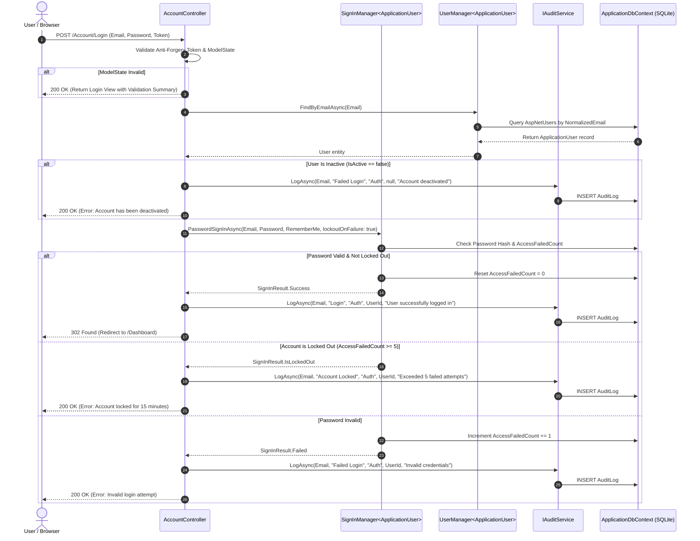
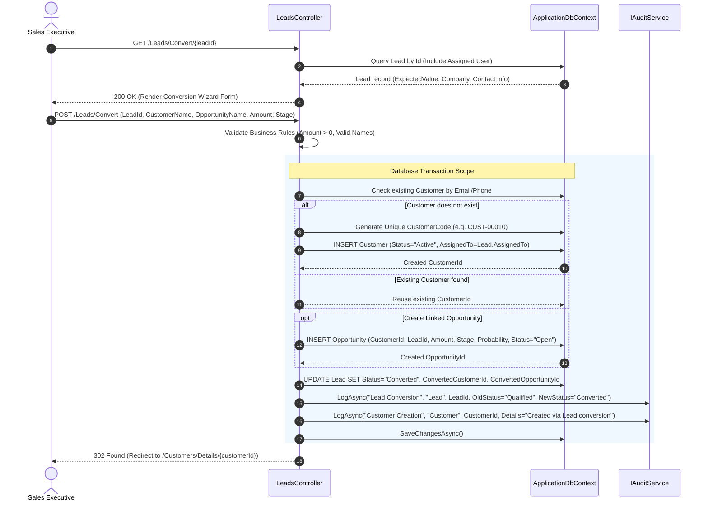
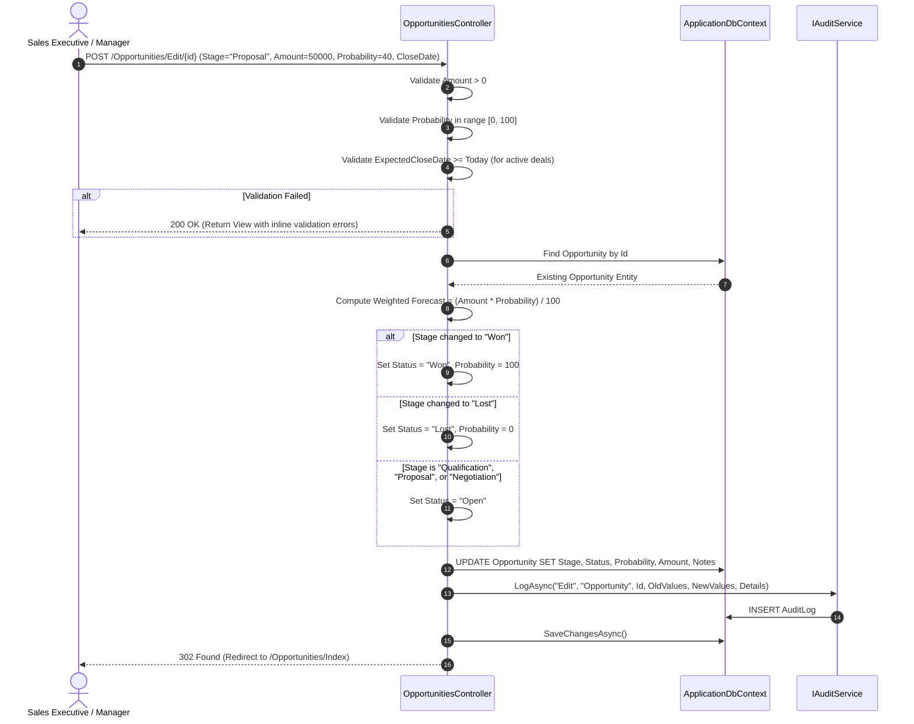
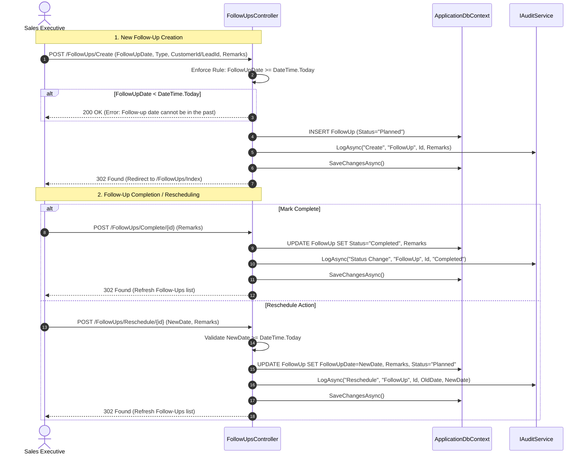
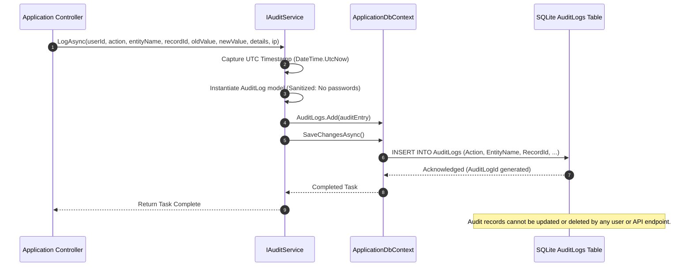
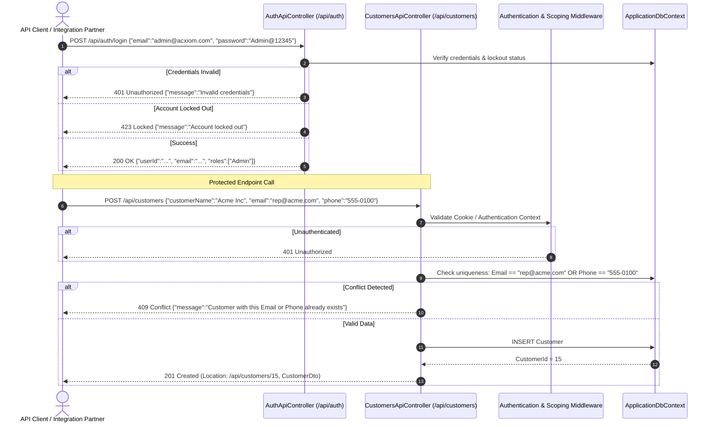

# CRM Workflows and Sequence Diagrams

## 1. Overview

This document illustrates the end-to-end business workflows and runtime sequence diagrams of the core processes in AcxiomCRM. Each diagram maps the communication between actors, controllers, services, database contexts, and audit logging pipelines.

---

## 2. Authentication, Session Creation, and Account Lockout Workflow

This workflow illustrates how user login credentials are validated, how consecutive failure counts trigger automatic account lockout, and how audit logs record every security event.

---

## 3. Lead Qualification and Conversion Workflow

This workflow represents the transition of a prospect from qualification to an active Customer and Opportunity, maintaining referential integrity across entities.

---

## 4. Opportunity Pipeline Stage Progression and Weighted Forecast Workflow

This workflow shows the transition of an Opportunity through sales stages, automatic recalculation of win probabilities, and dynamic forecast aggregation.

---

## 5. Follow-Up Scheduling, Rescheduling, and Overdue Processing Workflow

This workflow handles scheduling client follow-ups, date validation rules, status transitions, and prompt modal rescheduling.

---

## 6. Immutable Append-Only Audit Trail Pipeline

Every mutation across security and business domain entities flows into the centralized audit logging service.

---

## 7. REST API Authentication and Protected Request Lifecycle

This workflow documents how external consumers or automated integration systems interact with the AcxiomCRM REST API endpoints.

